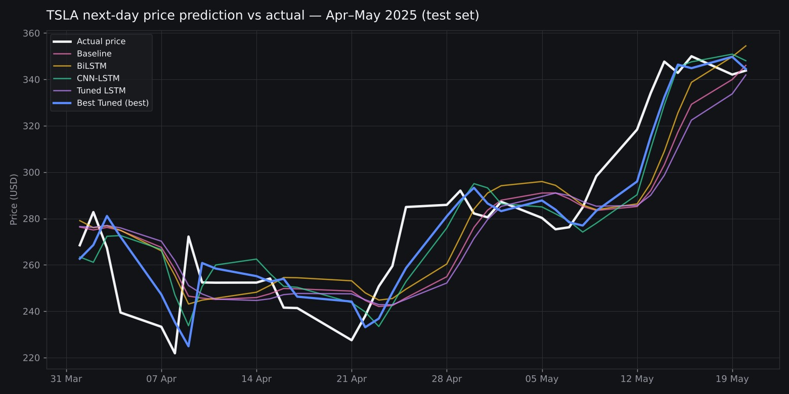
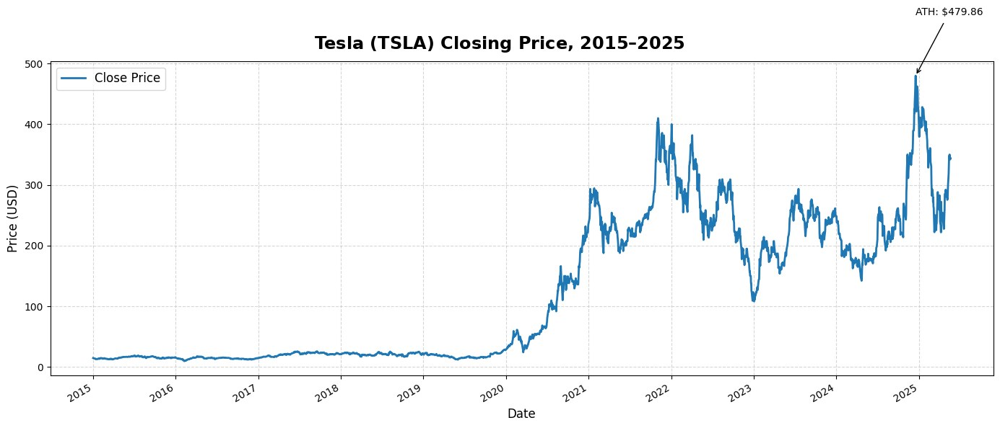
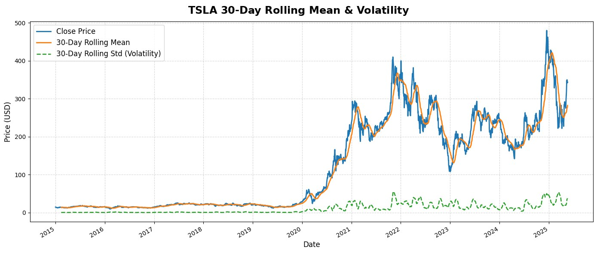
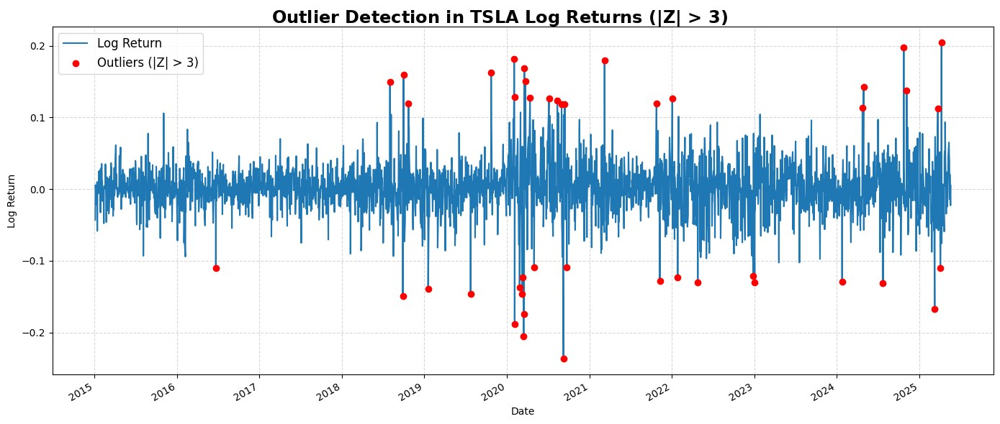

# 📈 Tesla (TSLA) Stock Price Forecasting with LSTM

Time-series forecasting of Tesla's daily closing price using five LSTM-based deep learning models, compared head-to-head with RMSE and MAPE.

> Machine Learning course project, Telkom University — May–June 2025. Group project (3 members); I built the full pipeline: EDA, preprocessing, all five models, hyperparameter tuning, and evaluation.

## 🧩 Problem

Stock prices are noisy, non-stationary, and prone to sudden jumps — TSLA in particular shows long calm periods followed by extreme volatility. The goal is to test how well different LSTM architectures can learn from the last 60 days of prices to predict the next day's close, and which architecture works best.

## 📊 Data

- **Source:** Yahoo Finance via `yfinance`
- **Period:** 1 Jan 2015 – 20 May 2025 · **2,611** trading days
- **Feature:** daily closing price (`Close`)
- **Split (chronological):** train 2015–2023 · validation 2024 · test 2025

## 🔍 Exploratory Data Analysis

- Price trend and all-time high ($479.86)
- 30-day rolling mean and rolling standard deviation (volatility)
- Daily log returns and their distribution — roughly bell-shaped but with **fat tails**
- Outlier detection with Z-score > 3 — extreme moves cluster around 2020–2021

| Price history | Rolling mean & volatility | Outliers (Z > 3) |
|---|---|---|
|  |  |  |

## 🧠 Models

All models take a **60-day sliding window** of MinMax-scaled prices and predict the next day's close.

| # | Model | Architecture |
|---|---|---|
| 1 | LSTM Baseline | LSTM(50) → Dense(1) |
| 2 | BiLSTM | Bidirectional LSTM(64) → Dropout(0.2) → Dense(1) |
| 3 | CNN-LSTM | Conv1D(64, k=3) → MaxPooling1D → LSTM(50) → Dense(1) |
| 4 | Manually tuned LSTM | LSTM(128) → Dropout(0.3) → Dense(1), lr 5e-4 |
| 5 | Auto-tuned LSTM | Keras Tuner RandomSearch (10 trials) → best: 96 units, dropout 0.1, lr 0.01 |

Training uses Adam + MSE loss with EarlyStopping and ReduceLROnPlateau.

## ✅ Results (test set, 35 trading days · Apr–May 2025)

| Model | RMSE (USD) | MAPE |
|---|---|---|
| **Auto-tuned LSTM** | **14.68** | **4.16%** |
| CNN-LSTM | 16.85 | 4.88% |
| BiLSTM | 20.09 | 6.04% |
| Baseline | 21.19 | 6.02% |
| Manually tuned LSTM | 22.54 | 6.33% |

**Takeaways**
- Automated hyperparameter search beat every hand-designed variant, cutting RMSE by ~31% versus the baseline.
- CNN-LSTM was the strongest hand-designed architecture — the convolution layer helps extract short-term local patterns.
- All models track the overall trend well but tend to lag sudden price jumps, a known limitation of one-step-ahead forecasting on price alone.

## 🛠️ Tech Stack

Python · TensorFlow / Keras · Keras Tuner · scikit-learn · pandas · NumPy · Matplotlib · Seaborn · Plotly · statsmodels · yfinance

## 🚀 How to Run

Open `TSLA_Stock_Prediction_LSTM.ipynb` in Google Colab or Jupyter and run all cells — the data is downloaded automatically with `yfinance`.

## 👤 Author

**Muhammad Zul Rezky Zaaki** — [GitHub](https://github.com/mhmmdzul) · [LinkedIn](https://linkedin.com/in/muhammadzulrezkyzaaki)
